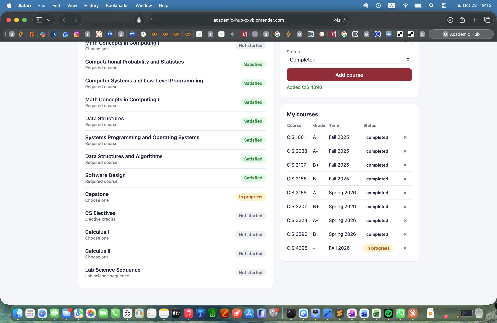
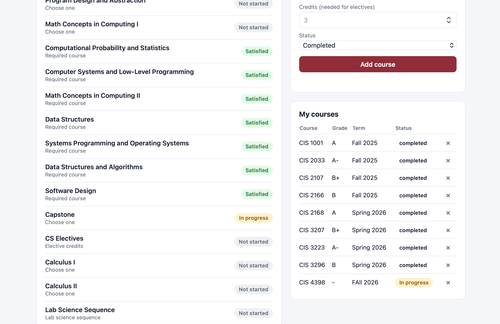

# Academic Hub

**The all-in-one student toolkit.** Degree audit today; GPA calculator and semester planner next.

**Live demo:** https://academic-hub-xxvb.onrender.com/app
(Fictional student data. The free server sleeps when idle, so the first load can take up to a minute. Anyone can edit the demo, and it resets on restart.)

## The problem

Students juggle degree requirements, grades and planning across PDFs, spreadsheets and advisor emails. I wanted one place that answers: *what have I finished, what is in progress, and what is left?*

## Status: work in progress

The degree audit is built and deployed. I am building the rest in stages, aiming for one tool that covers a student's whole academic life.

- [x] Degree audit (progress, in-progress and not-started tracking)
- [x] Log, list and delete courses, with credits
- [ ] GPA calculator
- [ ] Prerequisite graph and semester planner
- [ ] Capped independent-study credits
- [ ] Multiple majors selectable in the UI
- [ ] Japanese 

## Design decisions

**Requirements are data, not code.** Each major is a JSON file (`cs_major.json`). `load_major.py` loads it into the database, so adding a new major needs no code changes.

The audit engine supports four requirement types:

- `fixed`: one specific course
- `either_or`: pick one of several courses
- `credit_pool`: a number of credits from a list, with a one-course substitution cap
- `sequence`: finish both courses within one department (for example, lab sciences)

**Honest scope cuts.** I shipped a small, verified core first (all four rule types tested against real data) rather than a larger half-working tool.

**Privacy.** The public demo is rebuilt from fictional data every time it starts (`seed_demo.py`). My real transcript is never in the repository or on the server: the database is gitignored and the path is configurable with `DB_PATH`.

## Known limitations

- Lab science course codes in `cs_major.json` are placeholders and still need checking against the real catalog.
- Elective totals depend on credits stored in the course catalog (the Credits field in the form fills this in).
- Currently supports one major (CS_BS) from Temple University Japan's requirements page.

## Tech stack

FastAPI, SQLite, and a single plain HTML/JS page served at `/app`. Deployed on Render.

Endpoints: `GET /audit`, `GET/POST /courses`, `GET/POST /completed_courses`, `DELETE /completed_courses/{id}`, `GET /app`.

## Run locally

    git clone https://github.com/rokhayatou/academic-hub.git
    cd academic-hub
    python3 -m venv venv
    source venv/bin/activate
    pip install -r requirements.txt
    DB_PATH=demo.db python3 seed_demo.py   # fictional demo data
    DB_PATH=demo.db uvicorn main:app --reload

Then open http://127.0.0.1:8000/app

## About me

I'm a sophomore studying Computer Science at Temple University Japan, with minors in AI and Japanese. I'm interesred in building projects toward AI for healthcare and education in developing countries. Academic Hub started as a tool I wanted for myself, and I'm growing it into something any student can use.
